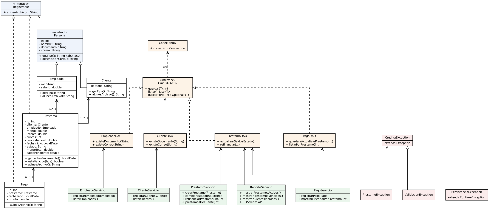

# CrediYa S.A.S. – Sistema de Gestión de Préstamos y Cobros

Sistema de consola en **Java 21** para digitalizar el control de préstamos personales y cobros de cartera de CrediYa S.A.S.
Gestiona **empleados, clientes, préstamos y pagos**, genera **reportes** con Stream API y guarda la información
tanto en **MySQL (JDBC)** como en **archivos de texto**.

---

## 1. Funcionalidades

| Módulo | Qué hace |
|---|---|
| **Empleados** | Registrar y listar empleados (id, nombre, documento, rol, correo, salario). |
| **Clientes** | Registrar y listar clientes (id, nombre, documento, correo, teléfono) y consultar sus préstamos y deuda total. |
| **Préstamos** | Crear préstamos asociando cliente y empleado. Calcula automáticamente el **monto total con interés** y la **cuota mensual**. Cambiar estado (PENDIENTE / PAGADO) y refinanciar (ampliar plazo). |
| **Pagos** | Registrar abonos, actualizar el saldo pendiente (y el estado a PAGADO cuando llega a cero) y ver el histórico de pagos general o por préstamo. |
| **Reportes** | Préstamos pendientes, pagados, **activos**, **vencidos**, **clientes morosos**, total prestado, saldo total, préstamos por cliente y por empleado (lambdas + Stream API). |
| **Archivos** | `empleados.txt`, `clientes.txt`, `prestamos.txt` y `pagos.txt` en la carpeta `archivos/`. Se actualizan solos después de cada registro y también desde el menú (opción 10). |

### Fórmulas

```
monto total   = monto + monto × (interés / 100)
cuota mensual = monto total / número de cuotas
vencimiento   = fecha de inicio + número de cuotas (meses)
```

Un préstamo está **vencido** si sigue PENDIENTE, tiene saldo y ya pasó su fecha de vencimiento.
Un cliente es **moroso** si tiene al menos un préstamo vencido.

### Reglas de pago

- No se puede pagar más que el saldo pendiente.
- El pago mínimo es una cuota mensual (salvo en la última cuota, donde se paga el saldo que falte).
- Un préstamo PAGADO no recibe más pagos ni se puede refinanciar.
- El pago y la actualización del saldo se guardan en **una sola transacción** (o se guardan los dos o ninguno).

---

## 2. Validaciones de los campos

Todos los datos se validan **al escribirlos en la consola** (se vuelve a preguntar hasta que el dato sea correcto)
y **otra vez en la capa de servicio** antes de guardar.

| Campo | Regla |
|---|---|
| Nombre | Solo letras (con tildes y ñ) y espacios, de 3 a 80 caracteres. Se guarda con mayúscula inicial (`juan  pérez` → `Juan Pérez`). |
| Documento | Solo números, de 6 a 10 dígitos, sin puntos ni espacios. **No se puede repetir.** |
| Correo | Formato `usuario@dominio.ext` (acepta `.com`, `.co`, `.com.co`, `.edu.co`…), máx. 80 caracteres. Se guarda en minúsculas. **No se puede repetir.** |
| Teléfono | Exactamente 10 números, empieza por 3 (celular) o 6 (fijo). |
| Rol | Se elige de una lista: ADMINISTRADOR, ASESOR, COBRADOR. |
| Salario | Número mayor que 0 y hasta 99.999.999,99. |
| Monto del préstamo | Entre 1 y 1.000.000.000. |
| Interés | Entre 0 % y 100 %. |
| Cuotas | Entero entre 1 y 120. |
| Valores con dinero | Solo números con máximo 2 decimales (`1500000` o `1500000.50`). Se rechazan letras, signos, puntos de miles, `1e5`, `Infinity`, etc. |
| IDs (cliente, empleado, préstamo) | Deben existir; si no, se vuelve a preguntar. |
| Opciones del menú | Solo números dentro del rango del menú. |

---

## 3. Estructura del proyecto

```
CrediYa/
├── pom.xml
├── README.md
├── archivos/                 ← archivos de texto generados
│   ├── empleados.txt
│   ├── clientes.txt
│   ├── prestamos.txt
│   └── pagos.txt
├── docs/
│   ├── diagrama_uml.png      ← diagrama de clases
│   ├── diagrama_uml.svg
│   └── diagrama_uml.dot      ← fuente (Graphviz)
├── sql/
│   └── crediya_db.sql        ← script de la base de datos + datos de prueba
└── src/main/
    ├── resources/
    │   └── db.properties     ← URL, usuario y contraseña de MySQL
    └── java/com/crediya/
        ├── Main.java                  ← menú de consola
        ├── modelo/        Persona (abstracta), Empleado, Cliente, Prestamo, Pago, Registrable
        ├── dao/           CrudDAO<T>, ConexionBD, EmpleadoDAO, ClienteDAO, PrestamoDAO, PagoDAO
        ├── servicio/      EmpleadoServicio, ClienteServicio, PrestamoServicio, PagoServicio, ReporteServicio
        ├── archivo/       GestorArchivos
        ├── excepciones/   CrediyaException, PrestamoException, ValidacionException, PersistenciaException
        └── util/          Validador, EntradaConsola, Formato, Constantes
```

---

## 4. Conceptos aplicados

**POO**
- **Herencia:** `Empleado` y `Cliente` extienden la clase abstracta `Persona` (id, nombre, documento, correo).
- **Polimorfismo:** `getTipo()`, `toString()` y `aLineaArchivo()` se redefinen en cada clase. `GestorArchivos` guarda
  cualquier lista de `Registrable` con un solo método, y el menú muestra clientes o empleados con `mostrarPersonas(List<? extends Persona>)`.
- **Encapsulamiento:** atributos privados con getters/setters.
- **Abstracción / interfaces:** `Registrable`, `CrudDAO<T>`.

**Colecciones, lambdas y Stream API:** `List`, `Map`, `Optional`, `filter`, `mapToDouble`, `sum`, `groupingBy`,
referencias a métodos (`Prestamo::getSaldoPendiente`) y `Predicate` para validar duplicados.

**Archivos:** escritura/lectura con `java.nio.file.Files` en UTF‑8, campos separados por `;`.

**JDBC:** `PreparedStatement` (evita inyección SQL), `try-with-resources`, claves generadas y transacciones (`commit`/`rollback`).

**SOLID y patrones**
- *S* – cada clase tiene una sola responsabilidad (DAO = SQL, Servicio = reglas, Validador = validaciones, Main = consola).
- *O / L* – nuevas entidades pueden implementar `Registrable` o extender `Persona` sin cambiar `GestorArchivos`.
- *I* – interfaces pequeñas (`Registrable`, `CrudDAO`).
- *D* – los servicios reciben sus DAO por constructor (inyección de dependencias), lo que permite probarlos sin base de datos.
- Patrones: **DAO**, **Service Layer**, **Factory** (`ConexionBD`).

**Excepciones:** jerarquía propia (`CrediyaException` → `PrestamoException`, `ValidacionException`) y
`PersistenciaException` para errores de base de datos con mensajes entendibles.

---

## 5. Diagrama UML



---

## 6. Cómo ejecutar

### Requisitos
- JDK 21
- Maven (incluido en NetBeans)
- MySQL 8

### Paso 1 – Crear la base de datos
En MySQL Workbench abra y ejecute `sql/crediya_db.sql`
(o en consola: `mysql -u root -p < sql/crediya_db.sql`).
La parte final del script carga datos de prueba; si no los quiere, bórrela antes de ejecutarlo.

> Si ya tenía la base `crediya_db` creada de antes, las tablas no se vuelven a crear (`IF NOT EXISTS`).
> Para empezar de cero ejecute primero `DROP DATABASE crediya_db;`.

### Paso 2 – Configurar la conexión
Edite `src/main/resources/db.properties` con su usuario y contraseña de MySQL:

```properties
db.url=jdbc:mysql://localhost:3306/crediya_db?useSSL=false&allowPublicKeyRetrieval=true&serverTimezone=America/Bogota
db.usuario=root
db.password=su_contraseña
```

### Paso 3 – Ejecutar
- **NetBeans:** abrir el proyecto → clic derecho → *Run* (la clase principal es `com.crediya.Main`).
- **Consola:**
  ```bash
  mvn clean compile exec:java
  ```

Los archivos de texto se crean en la carpeta `archivos/` dentro de la carpeta desde donde se ejecuta el programa.

---

## 7. Ejemplos de uso

**Registrar un cliente (con validaciones):**
```
===== REGISTRAR CLIENTE =====
Nombre: Juan123
Nombre inválido. Use solo letras y espacios (entre 3 y 80 caracteres), sin números ni símbolos.
Nombre: juan   pérez
Documento: 10.987.654
Documento inválido. Debe tener solo números, entre 6 y 10 dígitos, sin puntos ni espacios.
Documento: 1098765432
Correo: juan@correo
Correo inválido. Debe tener formato usuario@dominio.com (máx. 80 caracteres, sin espacios).
Correo: juan.perez@gmail.com
Teléfono: 300 123 4567
Teléfono inválido. Debe tener exactamente 10 números y empezar por 3 (celular) o 6 (fijo). Ej: 3001234567
Teléfono: 3001234567
Cliente guardado correctamente con ID 4.
```

**Crear un préstamo:**
```
Monto del préstamo: 2000000
Interés (%): 10
Número de cuotas (1 a 120): 6
Préstamo guardado correctamente con ID 4.

===== PRÉSTAMO CREADO =====
Cliente: Juan Pérez
Monto: $2.000.000,00
Interés: 10.0%
Monto total: $2.200.000,00
Cuota mensual: $366.666,67
Saldo pendiente: $2.200.000,00
Fecha de vencimiento: 2027-04-04
Estado: PENDIENTE
```

**Registrar un pago:**
```
Saldo pendiente: $2.200.000,00 | Cuota mensual: $366.666,67
Monto del pago: 1000
Error: El pago mínimo es de $366.666,67
...
Monto del pago: 366666.67
Pago registrado correctamente (ID 6).
Pago realizado: $366.666,67
Nuevo saldo: $1.833.333,33
Estado: PENDIENTE
```

**Reporte de clientes morosos (con los datos de prueba):**
```
===== CLIENTES MOROSOS =====
Cliente: Sofía Rangel
Documento: 1005666777
Correo: sofia.rangel@outlook.com
Préstamos vencidos: 1
Deuda total: $2.800.000,00
```

**Formato de los archivos (`archivos/prestamos.txt`):**
```
# id;cliente_id;empleado_id;monto;interes;cuotas;cuota_mensual;fecha_inicio;estado;monto_total;saldo_pendiente
1;1;2;2000000.00;10.00;6;366666.67;2026-06-01;PENDIENTE;2200000.00;1466666.66
```

---

## 8. Subir a GitHub

```bash
git remote add origin https://github.com/SU_USUARIO/CrediYa.git
git branch -M main
git push -u origin main
```

---

**Autor:** Oscar Gerardo Pinto Duarte
